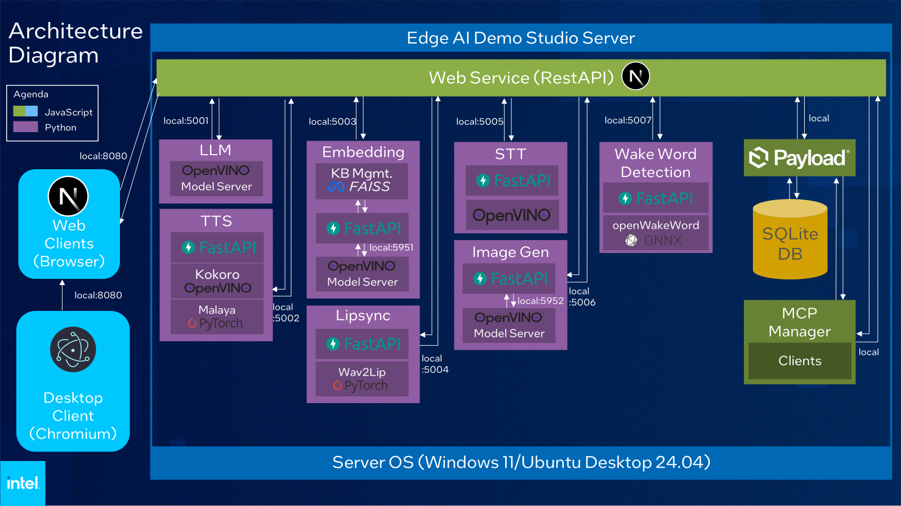

# Edge AI Demo Studio

Edge AI Demo Studio is a toolkit for deploying, managing, and serving AI models on edge platforms. It provides a web-based UI for device, workload, and user management, optimized for Intel hardware and edge environments.


---

## 1. Container Functional Overview

Edge AI Demo Studio packages a complete, self-contained edge AI workbench into a single container. From its web UI you can download Hugging Face models, convert them for Intel hardware, and serve them as ready-to-use inference endpoints — without building a bespoke pipeline for each model.

## 2. Container Key Features

- **Easy Model Deployment** — Download, convert, and serve Hugging Face models with minimal setup.
- **Web-Based Management** — Manage devices, workloads, and users through a modern web interface (port `8080`).
- **Edge Optimized** — Built for Intel hardware (CPU, GPU, NPU) and edge environments.
- **Ready-to-use AI Services:**
  - Text Generation (LLM)
  - Text to Speech (TTS)
  - Speech to Text (STT)
  - Embedding
  - Lipsync
  - Image Generation
  - MCP Manager
  - Wake Word Detection
- **Sample Applications** — Example use cases built on the AI services:
  - Digital Avatar
  - RAG Chat
  - [AI Exam Marking](./frontend/src/samples/ai-exam-marking/README.md)

## 3. Supported Host Device List

Edge AI Demo Studio targets **Intel platforms only**. CPU inference works on any supported Intel platform; GPU and NPU acceleration require the corresponding Intel hardware and host drivers (see Section 4).

> Non-Intel CPUs, GPUs, and accelerators (e.g. AMD, NVIDIA, Arm) are **not** supported for acceleration.

## 4. Prerequisite Software Libraries Installed on Host OS

## Requirement

- Ubuntu 24.04 with **Linux kernel 7.0 or newer** (on Ubuntu 24.04, the HWE kernel `linux-generic-hwe-24.04`)
- Intel GPU driver: [Intel® Open Middleware Xe (Intel OMIX)](https://dgpu-docs.intel.com/installation-guides/installing-omix.html) 0.4
- Intel NPU driver: [linux-npu-driver v1.38.0](https://github.com/intel/linux-npu-driver/releases/tag/v1.38.0)
- [Docker Engine](https://www.docker.com/get-started/) + Compose plugin

`setup.sh` installs the drivers and checks the kernel for you (see below). The container image ships its own copy of the GPU and NPU userspace drivers; the host provides the kernel drivers, the NPU firmware and the device nodes.

## Quick Start Guide

### 1. Run the Setup Script

```bash
bash setup.sh
```

This script will:

- Run `scripts/install_drivers.sh` (with sudo), which:
  - checks that the running kernel is 7.0 or newer, and on Ubuntu 24.04 offers to install the HWE kernel;
  - installs the Intel GPU driver ([Intel OMIX](https://dgpu-docs.intel.com/installation-guides/installing-omix.html)) from `repositories.intel.com`;
  - installs the Intel NPU driver ([v1.38.0](https://github.com/intel/linux-npu-driver/releases/tag/v1.38.0)) from GitHub, verified against its published SHA-256.

  Everything comes from `repositories.intel.com`, `github.com` and the Ubuntu archive; no Launchpad PPA is needed, so it works on networks that block Launchpad. On a host where an earlier installer added the `kobuk-team/intel-graphics` PPA, an apt pin (`/etc/apt/preferences.d/intel-omix`) keeps the Intel OMIX versions of the GPU runtime packages.
- Verify that Docker Engine (with the Compose plugin) is installed; if not, it prints install instructions and exits
- Generate `docker-compose.yml` from `docker-compose.template.yml`, detect Intel GPU (`/dev/dri`) and NPU (`/dev/accel`), and enable passthrough only for the devices that are present; it also writes the host's `render` group ID to `.env`

> **Reboot required after driver install** — The driver installer may install a new kernel or NPU firmware. When this happens the script will detect a reboot-required flag and exit with clear instructions. **Reboot the system and re-run `bash setup.sh`** — the second run will detect your GPU/NPU and configure `docker-compose.yml` automatically. Even if no flag is detected, a reboot is recommended before starting the container if drivers were just installed.

#### About `docker-compose.template.yml`

The repository ships only `docker-compose.template.yml`. You don't need to copy or edit it: `setup.sh` creates `docker-compose.yml` and `.env` from it (both are git-ignored). The GPU/NPU lines in the template are commented out on purpose, so `setup.sh` can enable just the devices this host has. Docker won't start the container if it lists a device that doesn't exist.

`setup.sh` regenerates `docker-compose.yml` from the template every time it runs, so manual edits to `docker-compose.yml` are lost on the next run. Put lasting changes in the template or in `.env`.

#### Manual setup (without `setup.sh`)

If the host drivers and Docker are already installed, you can create the files yourself from the repository folder:

```bash
cp docker-compose.template.yml docker-compose.yml
echo "RENDER_GROUP_ID=$(getent group render | cut -d: -f3)" >> .env
```

Then, in `docker-compose.yml`, uncomment `devices:`, `group_add:` and the entries for your hardware (remove the leading `# `). On a host with both a GPU and an NPU, the result is:

```yaml
    devices:
      - "/dev/dri:/dev/dri"     # GPU
      - "/dev/accel:/dev/accel" # NPU
    group_add:
      - ${RENDER_GROUP_ID:-992}
```

On a GPU-only host, leave the `/dev/accel` line commented, and vice versa for an NPU-only host. On a CPU-only host, leave the whole block commented.

### 2. Pull the Image

`docker-compose.yml` runs `harbor.edgesync.cloud/intel/edge-ai-demo-studio:v1.0.0` from the public Harbor registry. `docker compose up -d` pulls it on first start; to pull it in advance (about 7 GB):

```bash
docker compose pull
```

The image includes the same Intel OMIX and NPU userspace drivers as the host, and both llama.cpp builds (SYCL and Vulkan) for the LLM engine.

### 3. Start the App

```bash
docker compose up -d
```

Once started, access the web UI at [http://127.0.0.1:8080](http://127.0.0.1:8080) on this device. The container shares the host's network and the app listens on `127.0.0.1` only, so port `8080` must be free on the host and the UI is not reachable from other machines.

LLMs run on the SYCL llama.cpp build by default. To use Vulkan instead, add `LLAMACPP_BACKEND=vulkan` to the `.env` file next to `docker-compose.yml` and run `docker compose up -d` again. `setup.sh` keeps that line when it re-runs.

### 4. Verify Installation (Optional)

```bash
bash wise-bench.sh
```

`wise-bench.sh` is a diagnostics tool that verifies your host environment and the running container. It checks and reports on:

- **System info** — hostname, OS, kernel, CPU, and memory
- **Host software** — Docker Engine, Compose plugin, kernel version (7.0 or newer), Intel OMIX, NPU driver (v1.38.0), Level Zero, and device nodes (`/dev/dri`, `/dev/accel`)
- **Intel GPU** — kernel driver, GPUs bound to it, OpenVINO GPU enumeration, and PyTorch XPU support
- **Intel NPU** — driver presence and OpenVINO NPU detection
- **Docker container** — whether the `edge-ai-demo-studio` container is running and the image size
- **Container accelerators** — device passthrough into the container, the GPUs and NPU OpenVINO sees inside it, and GPU usage monitoring (qmassa)
- **Web UI / API** — whether the service is reachable on port `8080`
- **Overall score** — a summary pass/fail across all checks with a progress bar

A full log is saved to `/tmp/wise-bench.log` for later review. Run this script after setup to confirm everything is working, or when troubleshooting an issue.

### 5. Persistent data

The following Docker volumes persist across restarts:

| Volume   | Mount                 | Contents                      |
| -------- | --------------------- | ----------------------------- |
| `models` | `/home/ubuntu/models` | Downloaded & converted models |
| `logs`   | `/home/ubuntu/logs`   | Application logs              |
| `db`     | `/home/ubuntu/data`   | SQLite database               |

### Architecture Diagram



## 8. Best Practice / Known Limitations

**Best practices:**

- Pull the image (step 2) before deployment on slow or metered networks; it is about 7 GB.
- Allocate enough RAM and storage for the largest model you intend to run; model conversion needs temporary headroom.
- Use the `models` volume so converted models survive container restarts and upgrades.
- Verify host GPU/NPU drivers are installed and the device nodes (`/dev/dri`, `/dev/accel`) exist before enabling acceleration.

**Known limitations:**

- **Intel hardware only** — GPU/NPU acceleration is not available on non-Intel platforms; such hosts fall back to CPU inference.
- NPU acceleration requires Intel® Core™ Ultra (Meteor Lake) or newer.
- GPU and NPU acceleration require Linux kernel 7.0 or newer on the host; Intel OMIX is validated on Intel® Arc™ Pro B50/B60/B65/B70.
- GPU acceleration requires the host render group to be passed into the container.
- The web UI is only reachable on the device itself (`127.0.0.1:8080`).
